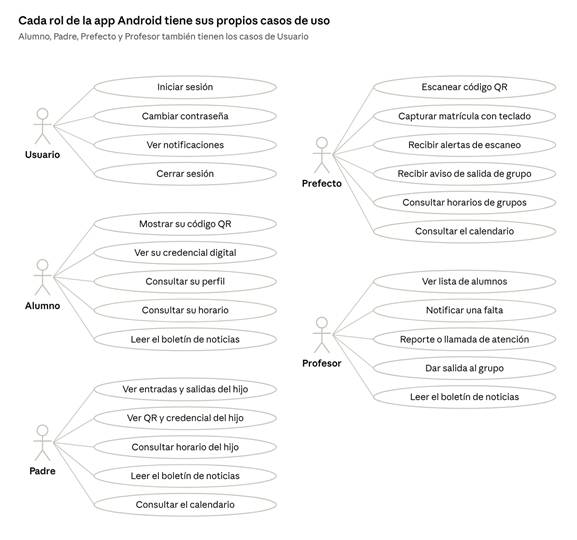
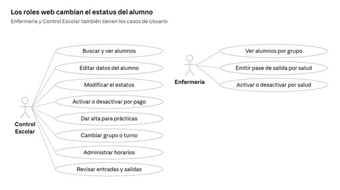
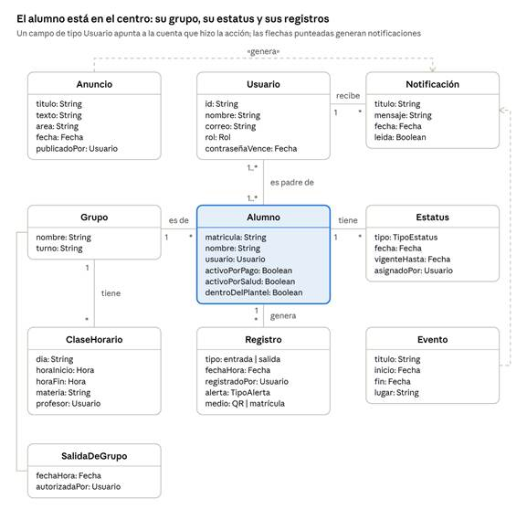
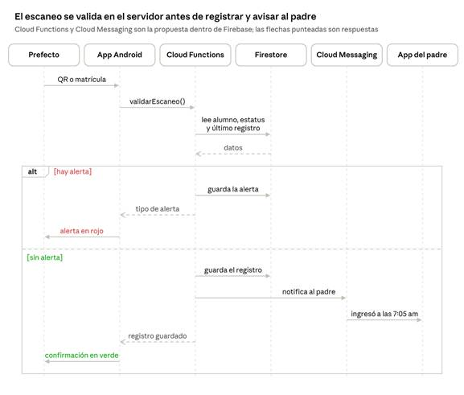
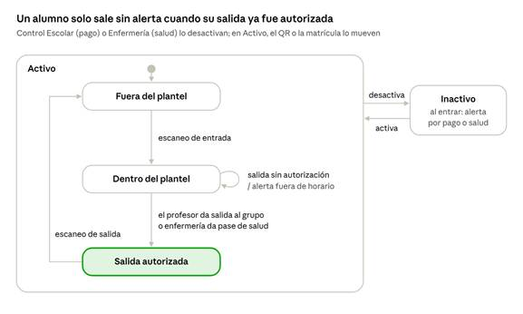
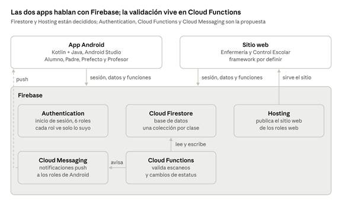

# CetisAsiste — Pantallas por rol

> **Qué es este archivo:** la copia en texto del documento original del usuario
> **"CetisAsiste — Pantallas por rol"** (7 de octubre de 2026), para que cualquier persona o
> agente lo pueda leer sin abrir Word. El original está junto a este archivo:
> [`PANTALLAS_POR_ROL_original.docx`](PANTALLAS_POR_ROL_original.docx). Los diagramas están
> en [`pantallas_por_rol/`](pantallas_por_rol/).
>
> - El texto y las tablas se copiaron **tal cual** (agregado al proyecto el 19 de octubre).
>   Lo único nuevo es la **sección final**, que compara el documento con lo que ya tiene la
>   app.
> - **No se genera `.docx` de este archivo**: la versión Word es el original.
> - Si el documento cambia, reemplaza el original y actualiza esta copia.

**Oct 7, 2026 · @Abraham**

## Resumen

CetisAsiste controla las entradas y salidas del CETis 61 Cd. Juárez con seis roles: Alumno,
Padre de familia, Prefecto y Profesor en Android; Enfermería y Control Escolar probablemente
solo en web. Las cuentas las da de alta el plantel, no hay registro desde la app.

| Rol | Qué hace | Plataforma propuesta |
|---|---|---|
| Alumno | Muestra su código QR y credencial digital; consulta su perfil (sin modificarlo), su horario y el boletín de noticias | Android |
| Padre de familia | Sigue las entradas y salidas de su hijo, los avisos y el calendario del plantel | Android |
| Prefecto | Escanea a los alumnos o teclea su matrícula en el acceso y recibe alertas y avisos de salida de grupos | Android |
| Profesor | Cambia el estatus de sus alumnos y da salida al grupo en la última clase | Android |
| Enfermería | Da pases de salida por salud y activa o desactiva al alumno por salud | Web (por confirmar) |
| Control Escolar | Administra alumnos, estatus, grupos, turnos, prácticas, horarios y el estado por pago | Web |

**Propuesta para el debate:** Control Escolar solo en web tiene sentido, porque su trabajo es
captura y consulta masiva (tablas, filtros, edición de datos), lento y propenso a errores en
un celular. Enfermería en web funciona si atienden desde la computadora del consultorio; si
salen a atender fuera, conviene una vista Android mínima solo para emitir el pase.

## Pantallas comunes

Todos los roles comparten el acceso y las notificaciones; lo que cambia por rol es lo que
aparece después de iniciar sesión.

| Pantalla | Para qué sirve | Wireframe |
|---|---|---|
| Bienvenida | Muestra CetisAsiste mientras abre la app | Hecho |
| Iniciar sesión | Matrícula o usuario y contraseña (cómo entra el padre, por definir) | Hecho |
| Cambio de contraseña obligatorio | Aparece cuando la contraseña vence; obligatorio para el prefecto, propuesto para todo el personal | Hecho |
| Recuperar contraseña | Desde "¿Olvidaste tu contraseña?" en el inicio de sesión | Pendiente |
| Notificaciones | Avisos personales; el contenido cambia según el rol | Hecho |
| Cerrar sesión | Opción en Perfil o en el menú; regresa a Iniciar sesión | Hecho |

## Alumno (Android)

El alumno muestra su código QR y su credencial digital, y consulta su perfil, su horario y el
boletín de noticias, sin poder modificar sus datos. Código QR y Credencial digital reutilizan
los wireframes ya hechos; Perfil, Horario y Anuncios del padre sirven de base para el resto.

| Pantalla | Para qué sirve | Wireframe |
|---|---|---|
| Código QR | El código que escanea el prefecto al entrar y salir | Hecho |
| Credencial digital | Su credencial de estudiante en la app | Hecho |
| Perfil | Sus datos personales en solo lectura (matrícula, grupo, correo) | Hecho |
| Horario | Su horario de clases | Hecho |
| Boletín de noticias | Avisos generales del plantel | Hecho |

## Padre de familia (Android)

Los 11 wireframes hechos son del padre: sigue las entradas y salidas de su hijo y recibe los
avisos del plantel. Algunos textos todavía hablan como si el usuario fuera el alumno y hay que
ajustarlos.

| Pantalla | Para qué sirve | Wireframe |
|---|---|---|
| Inicio | Resumen del hijo, aviso destacado y accesos rápidos | Hecho |
| Entradas y salidas | Historial por día de cuándo entró y salió su hijo | Hecho |
| Notificaciones | Aviso en el momento en que su hijo entra o sale, avisos nuevos | Hecho |
| Código QR | Código del hijo (uso por confirmar) | Hecho |
| Credencial digital | Credencial del hijo | Hecho |
| Horario | Horario de clases del hijo (solo tiene encabezado) | Pendiente |
| Anuncios | Boletín de noticias del plantel | Hecho |
| Calendario | Eventos escolares del mes | Hecho |
| Perfil | Datos del hijo en solo lectura | Hecho |

**Ajustes pendientes en Figma:** Inicio y Perfil presentan al hijo como si fuera el usuario
("Estudiante", "Mi credencial digital", "Mis entradas y salidas"), y Notificaciones dice
"Registraste tu entrada". Para el padre deben usar el nombre del hijo, como ya lo hace
Entradas y salidas.

## Prefecto (Android)

El prefecto tiene dos funciones: escanear a los alumnos en el acceso, o teclear su matrícula
si el QR no se lee, y recibir avisos cuando un grupo ya salió de clases. Su cuenta la da de
alta el plantel y la app le pide cambiar la contraseña cada cierto tiempo.

| Pantalla | Para qué sirve | Wireframe |
|---|---|---|
| Inicio del prefecto | Acceso directo al escáner y últimos escaneos | Hecho |
| Escáner QR | Cámara para leer el código del alumno | Hecho |
| Captura por matrícula | Teclado numérico para registrar la entrada o salida con la matrícula cuando el QR no se puede leer | Hecho |
| Resultado del escaneo | Confirma la entrada o salida, o muestra una alerta | Hecho |
| Notificaciones | Aviso cuando un grupo ya salió de clases | Hecho |
| Horarios de todos los grupos | Consulta, para saber qué grupo debería estar en clase | Hecho |
| Calendario | Eventos escolares | Propuesta |
| Cambio de contraseña | Obligatorio cuando vence | Hecho |

Alertas que aparecen al escanear:

| Alerta | Cuándo aparece |
|---|---|
| Alumno no dado de alta | El código o la matrícula tecleada no corresponde a ningún alumno registrado |
| Alumno inactivo | Al entrar, está inactivo por pago (Control Escolar) o por salud (Enfermería) |
| Alumno que ya ingresó | Se escanea su entrada cuando ya tenía una registrada |
| Alumno que no ha ingresado | Intenta salir sin tener entrada registrada |
| Alumno con castigo disciplinario | Su estatus tiene un castigo vigente |
| Salida fuera de horario | Sale antes de que su profesor libere al grupo o sin pase de enfermería |

## Profesor (Android)

El profesor cambia el estatus de sus alumnos y, en la última clase del turno, da salida a todo
el grupo para que el prefecto no reciba alertas al escanearlos. Notificar faltas no es pasar
lista.

| Pantalla | Para qué sirve | Wireframe |
|---|---|---|
| Inicio del profesor | Sus grupos y accesos rápidos | Hecho |
| Lista de alumnos | Alumnos de cada uno de sus grupos | Hecho |
| Perfil del alumno | Datos y estatus del alumno; desde aquí se modifica | Hecho |
| Cambiar estatus | Notificar falta, levantar reporte o llamada de atención | Hecho |
| Dar salida al grupo | Solo en la última clase del turno; avisa al prefecto | Hecho |
| Boletín de noticias | Los mismos avisos generales que ve el alumno | Hecho |

## Enfermería (web, por confirmar)

Enfermería funciona como el profesor, pero ve a todos los alumnos por grupo y, en lugar de
estatus disciplinarios, da pases de salida por salud que le permiten salir. También activa o
desactiva al alumno por salud: mientras está inactivo, el escáner muestra una alerta al entrar.

| Pantalla | Para qué sirve | Wireframe |
|---|---|---|
| Alumnos por grupo | Todos los grupos del plantel, con búsqueda | Hecho |
| Perfil del alumno | Datos y estatus del alumno | Pendiente |
| Pase de salida por salud | Registra el pase; el prefecto lo ve al escanear y no hay alerta | Hecho |
| Estado de salud | Activar o desactivar al alumno; si está inactivo, el escáner muestra una alerta al entrar | Hecho |

## Control Escolar (web)

Control Escolar es lo más cercano a un administrador: ve y modifica casi todo sobre los
alumnos, incluido su estado por pago: si no ha pagado, lo desactiva y el escáner muestra una
alerta al entrar. Por eso se propone solo en web.

| Pantalla | Para qué sirve | Wireframe |
|---|---|---|
| Alumnos | Todos los alumnos, con búsqueda y filtros por grupo y turno | Hecho |
| Estado de pago | Activar o desactivar al alumno según si pagó, con historial de cambios | Hecho |
| Perfil del alumno | Consultar y editar sus datos | Hecho |
| Estatus del alumno | Consultar y modificar cualquier estatus | Pendiente |
| Altas para prácticas | Registrar al alumno que sale a prácticas | Pendiente |
| Cambio de grupo o turno | Mover al alumno de grupo o turno | Pendiente |
| Horarios | Consultar y administrar los horarios de los grupos | Pendiente |
| Entradas y salidas | Revisar quién ya entró o salió | Pendiente |

## Estatus del alumno y alertas

Lo que profesores, Enfermería y Control Escolar registran en el estatus del alumno es lo que
el prefecto ve al escanear. Control Escolar puede modificar cualquier estatus.

Un alumno pasa sin alerta solo si está dado de alta, no tiene castigo y su entrada o salida
coincide con su registro y con la autorización de su profesor o de Enfermería.

| Estatus | Quién lo pone | Efecto al escanear |
|---|---|---|
| Castigo disciplinario | Por definir (profesor o Control Escolar) | Alerta al prefecto |
| Grupo liberado | Profesor, en la última clase del turno | Salida sin alerta |
| Pase de salida por salud | Enfermería | Salida sin alerta |
| Falta notificada | Profesor | Por definir |
| Reporte o llamada de atención | Profesor | Por definir |
| Alta para prácticas | Control Escolar | Por definir |
| Inactivo por pago | Control Escolar | Alerta al entrar |
| Inactivo por salud | Enfermería | Alerta al entrar |

## Preguntas abiertas

Estas decisiones cambian qué pantallas se diseñan y cómo funcionan las alertas.

- ¿Control Escolar y Enfermería quedan solo en web?
- ¿Con qué inicia sesión el padre: la matrícula del hijo o un usuario propio? ¿Qué pasa si
  tiene más de un hijo en el plantel?
- ¿El padre también puede mostrar el código QR de su hijo, o solo lo ve como consulta?
- ¿Cada cuánto vence la contraseña, y aplica solo al prefecto o a todo el personal?
- ¿Quién da de alta a alumnos, padres y personal: Control Escolar desde la web?
- ¿Cómo está organizado el plantel: cuántos turnos, cómo se nombran los grupos?
- ¿Quién asigna un castigo disciplinario y cuánto dura?
- ¿Qué diferencia hay entre reporte y llamada de atención, y el padre o el alumno los ven?
- ¿Qué hace el prefecto ante cada alerta: deja pasar, retiene o avisa a alguien?
- ¿El prefecto consulta horarios de todos los grupos y el calendario?
- ¿El profesor recibe notificaciones?
- ¿El alumno y el padre ven en la app si el alumno está inactivo?

## Estado de los wireframes

Ya hay wireframes de los seis roles, cada uno en su propia página del archivo: 11 del Padre
(incluido el acceso), 6 del Alumno, 8 del Prefecto más el tablero de alertas, 5 del Profesor y
5 web para Control Escolar y Enfermería. Están en **CETis 61 - Inicio (Android)** en Figma, a
360 × 800, conectados como prototipo.

Los del Padre, en el orden del lienzo: Bienvenida, Iniciar sesión, Inicio, Código QR,
Credencial digital, Entradas y salidas, Horario (solo encabezado), Anuncios, Calendario,
Perfil y Notificaciones.

Siguientes, en orden propuesto:

1. Revisar las preguntas abiertas, sobre todo qué hace el prefecto después de cada alerta
2. Ajustar los textos del padre para que hablen del hijo
3. Recuperar contraseña, y el horario del padre a partir del que ya tiene el alumno
4. Web que falta: horarios y entradas y salidas de Control Escolar, y el perfil del alumno en
   Enfermería
5. Cambiar los datos de ejemplo (nombres, grupos, materias y horas) por los reales

## UML: casos de uso

Todos los roles comparten los casos de Usuario: iniciar sesión, cambiar contraseña, ver
notificaciones y cerrar sesión. El resto depende del rol y de la plataforma.

En Android, el alumno y el padre solo consultan; el prefecto y el profesor son los que generan
registros y cambios de estatus.

En la web, Control Escolar concentra casi toda la administración; Enfermería da pases de
salida y, como Control Escolar con el pago, activa o desactiva al alumno por salud.

## UML: clases

El modelo gira alrededor del alumno: a qué grupo pertenece, qué estatus tiene y qué registros
de entrada y salida genera. En Firestore cada clase sería una colección y las relaciones se
guardan como el id del documento relacionado.

Los seis roles comparten la clase Usuario y se distinguen por el campo rol, así un mismo
inicio de sesión sirve para todos.

| Tipo | Valores |
|---|---|
| Rol | alumno, padre, prefecto, profesor, enfermería, control escolar |
| TipoEstatus | castigo disciplinario, falta, reporte, llamada de atención, pase de salida por salud, alta para prácticas |
| TipoAlerta | no dado de alta, ya ingresó, no ha ingresado, castigo disciplinario, alumno inactivo, salida fuera de horario |
| Medio (del registro) | QR escaneado, matrícula tecleada |

## UML: secuencia del escaneo

El escaneo es el caso de uso central. La app del prefecto no decide sola: envía la matrícula
a una función en Firebase que revisa estatus y registros, guarda el resultado y, si todo está
en orden, avisa al padre.

Validar en el servidor evita que una app modificada registre entradas sin pasar por las reglas
de la sección de estatus y alertas.

Si el QR no se puede leer, el prefecto teclea la matrícula en la pantalla de captura; desde
ahí el flujo es el mismo, con las mismas alertas, y el registro guarda que se hizo por
matrícula.

## UML: estados del alumno

El alumno tiene dos estados que cambian por separado: su cuenta (activa o inactiva por pago,
según Control Escolar, y por salud, según Enfermería) y dónde está (fuera, dentro o con salida
autorizada, según los escaneos y las autorizaciones).

Un alumno inactivo por pago o por salud genera alerta al entrar. Qué hace el prefecto después
de una alerta sigue en las preguntas abiertas.

## Arquitectura

La app Android se hace en Kotlin y Java con Android Studio; los datos viven en Cloud Firestore
y la web se publica en Firebase Hosting. Para lo demás se proponen servicios del mismo
Firebase, así todo queda en un solo proyecto.

Las apps leen datos directamente de Firestore, pero todo lo que cambia un registro o un
estatus pasa por Cloud Functions, que aplica las reglas antes de guardar. Las reglas de
seguridad de Firestore limitan qué puede leer cada rol.

| Pieza | Tecnología | Estado |
|---|---|---|
| App Android | Kotlin + Java, Android Studio | Decidido |
| Base de datos | Cloud Firestore | Decidido |
| Sitio web | Firebase Hosting; framework por definir | Decidido el hosting |
| Inicio de sesión y roles | Firebase Authentication | Propuesta |
| Validaciones del escaneo y del estatus | Cloud Functions | Propuesta |
| Notificaciones push | Firebase Cloud Messaging | Propuesta |

---

## Comparación con la app (19 de octubre de 2026)

*Esta sección no es del documento original: la agregó el agente al copiarlo al proyecto.*

### Lo que ya coincide

- Los seis roles, quién está en Android y quién en web, y que nadie se registra desde la app.
- El inicio de sesión con matrícula o usuario (ADR-003), y Authentication ya está en uso.
- El modelo de datos: las 10 clases son colecciones de Firestore (ADR-004). La app guarda
  "dónde está el alumno" como `ubicacion` (fuera, dentro o salida autorizada), igual que el
  diagrama de estados, en lugar del `dentroDelPlantel` del diagrama de clases.
- Los tipos de estatus, las seis alertas y el medio del registro (QR o matrícula).
- Pantallas de alumno, padre, prefecto y profesor (vistas XML), menos el escaneo.
- El horario del padre ya se armó con el del alumno, como propone el paso 3 de "Siguientes".

### Lo que la app hace distinto o de más (para que el usuario decida)

| Tema | Documento | App hoy |
|---|---|---|
| Validación del escaneo | Pasa por Cloud Functions | Todavía no hay escaneo. Cloud Functions necesita el plan Blaze; mientras, las reglas limitan quién escribe (ADR-002) |
| Profesor: tipos de estatus | Falta, reporte o llamada de atención | También deja poner **castigo**, porque las reglas lo permiten. El documento dice "por definir (profesor o Control Escolar)" |
| Profesor: notificaciones | Pregunta abierta | Tiene la campana de Notificaciones en su Inicio |
| Profesor: horario del grupo | No está | Agregado (se abre desde el grupo) |
| Prefecto: Inicio | Acceso al escáner y últimos escaneos | Accesos (el escáner dice "Próximamente") y los grupos que salieron hoy, en tiempo real |
| Prefecto: calendario y horarios | Pregunta abierta / Propuesta | Los tiene, como pestañas |
| Prefecto y profesor: Perfil | No está | Agregado, para cambiar la contraseña y cerrar sesión |
| Vencimiento de la contraseña | Pregunta abierta: ¿solo prefecto o todo el personal? | Al cambiarla, vence a los 90 días **para cualquier rol**, incluidos alumno y padre (`diasVenceContrasena`) |
| Textos del padre | Hay que ajustarlos para que hablen del hijo | Siguen como en Figma ("Estudiante", "Mi credencial digital", "Mis entradas y salidas") |
| Diseño de prefecto y profesor | Hay wireframes en "CETis 61 - Inicio (Android)" | Se armaron con el estilo del alumno antes de encontrar esas páginas; las diferencias están en [FIGMA.md](FIGMA.md) |

### Notas sobre el original

- Después del texto de "Estatus del alumno y alertas" aparece un texto suelto, "e store", que
  parece un resto de edición. No se copió.
